# 知更 AI · 成都大学校园机会雷达

> 自定义信息源聚合器：自己配置或联网搜索添加校园网站，系统定时抓取、按类别提取不同字段，先给「今天该做什么」的结论，再提供完整检索清单。

成都大学第八届网络创新大赛 · AI 创作挑战赛（进阶组）参赛作品。**本仓库为参赛作品，非学校官方平台。**

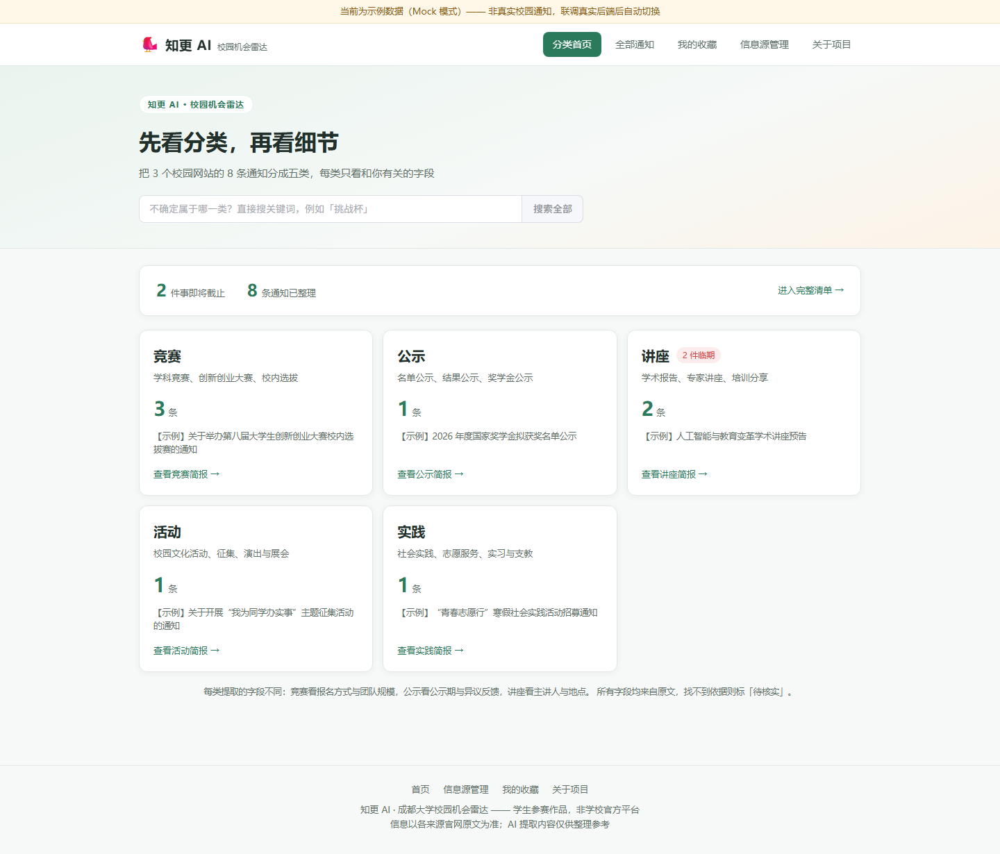

## 它解决什么问题

校园通知散落在学校官网、各学院站点、公众号与班级群里：格式不统一、截止日期藏在正文第三段、附件要一个个点开。知更 AI 把这件事收敛成三件事：

| 痛点 | 做法 |
| --- | --- |
| 通知分散、要挨个网站刷 | 联网关键词搜索校园网站或直接粘贴网址，一键添加并自动探测，定时抓取统一入库 |
| 不同通知要看的东西不一样 | 按教务处与学院官网真实内容分三组十四类，每类提取专属字段（考试时间、异议反馈、主讲人、团队规模…） |
| 信息太多、还是得自己翻 | 首页只显示三组，可自选重点关注的类别；组内只列还能行动的机会，卡片直接写清倒计时与下一步 |

## 界面预览

| 分组首页 | 重点关注类别设置 |
| --- | --- |
| 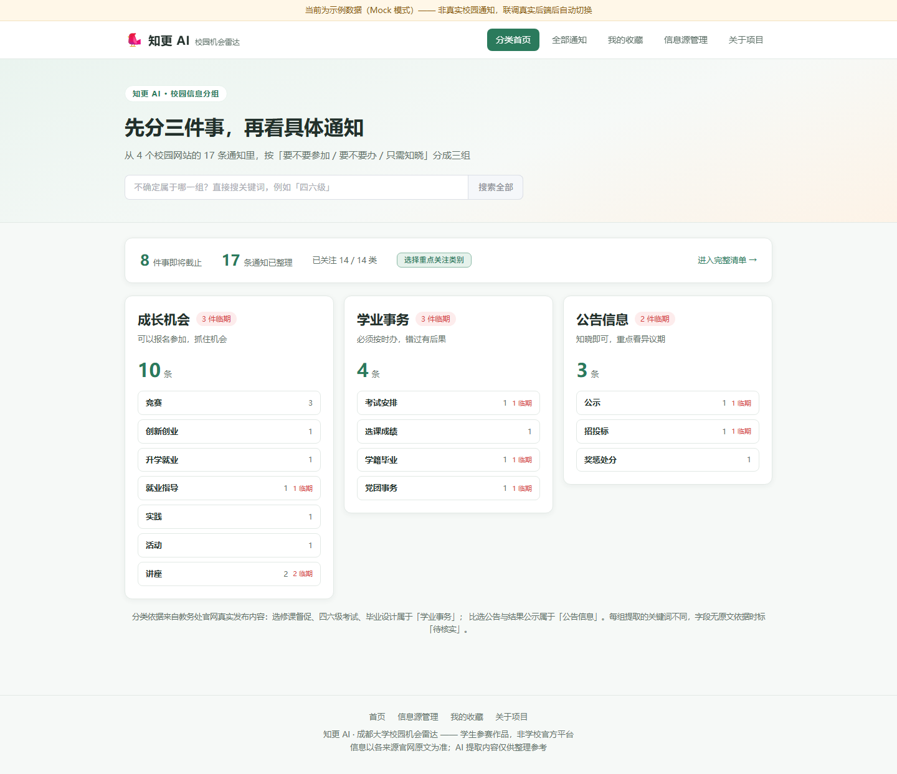 | 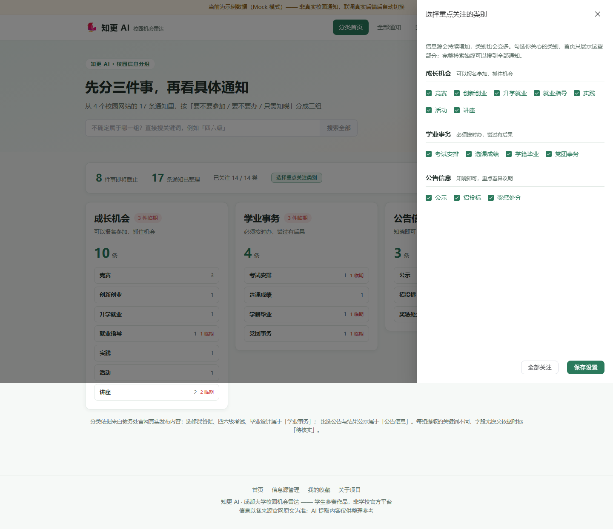 |

| 分类简报（公示类专属字段） | 全部通知（筛选 + 排序） |
| --- | --- |
| 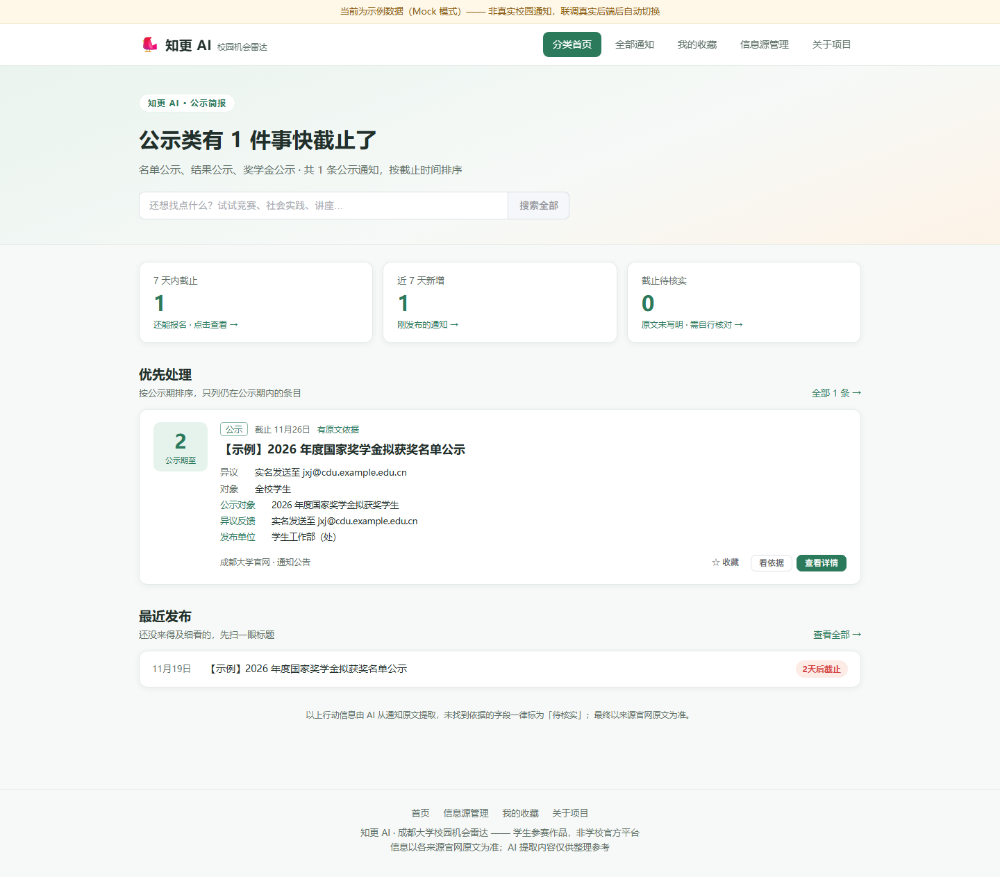 | 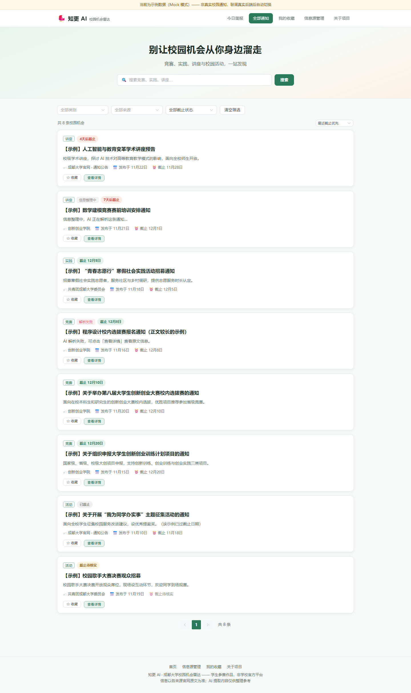 |

| 全部通知（筛选 + 排序） | 通知详情（AI 字段 + 原文依据 + 正文） |
| --- | --- |
|  | 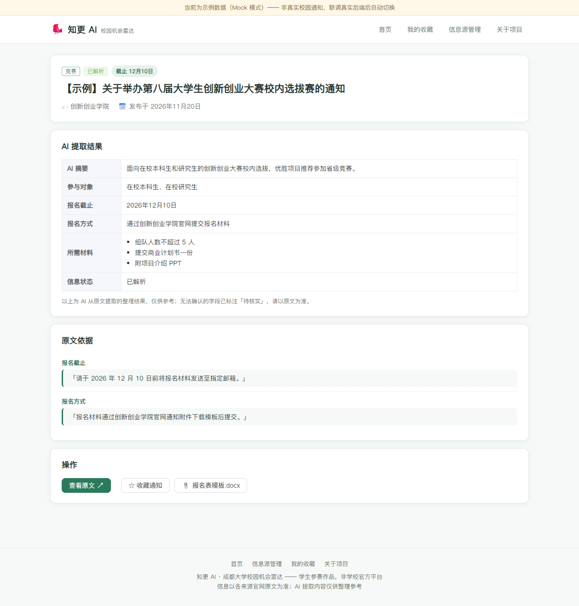 |

| 联网搜索添加信息源 | 网址探测结果 |
| --- | --- |
| 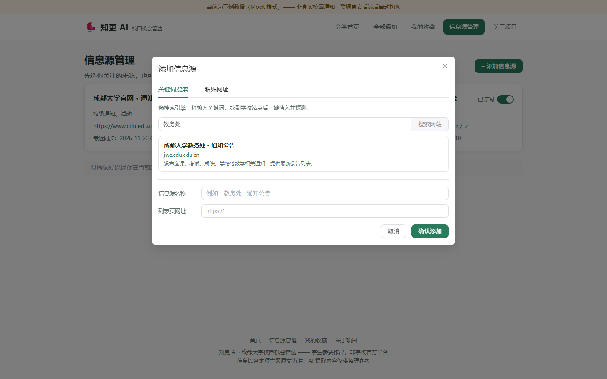 | 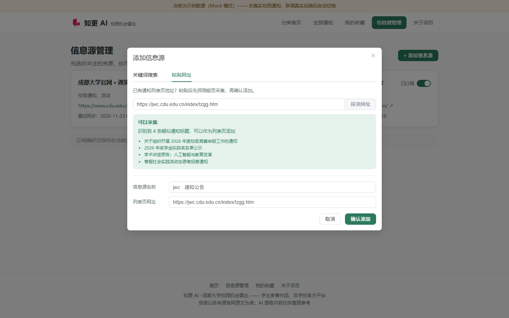 |

移动端：

| 分组首页 | 分类简报 | 全部通知 | 详情 |
| --- | --- | --- | --- |
| 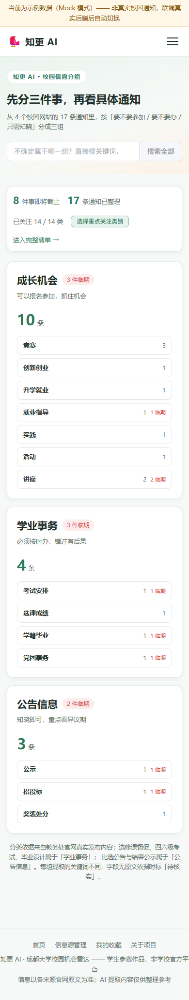 | 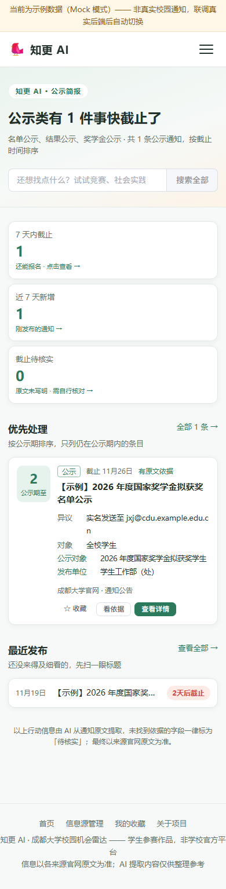 | 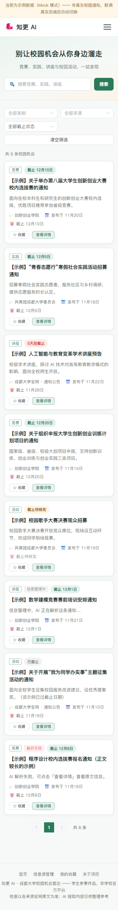 |  |

> 分组首页、类别设置与分类简报截图为 **Mock 模式的虚构示例数据**，页面顶部有黄色提示条标识；其余截图含真实数据模式。示例覆盖成都大学教务处与计算机学院官网的真实栏目结构。

## 已实现的功能

**我的本周日历（周视图）**
- 把截止日期、考试与活动时间铺到周一至周日，今天高亮，过去的日子淡显，一眼看出哪天撞车
- 可翻上一周 / 下一周；同一天内整日事件（如「截止」）排在前面，再按具体时间排
- 每张卡片标明「截止」还是「考试时间」等原文用词，点开直达详情核对
- 同一通知被多个来源转载时按标题归一化合并，避免同一天出现两张一样的卡片
- 原文没写日期的通知**不会被推测着塞进日历**，这类一律留在「全部通知」里标「待核实」

**「问知更」自然语言问答**
- 首页与「全部通知」页都有入口：直接问「这周有什么比赛能报名？」「四级什么时候报名？」，不用先想关键词
- 回答给结论 + **原文依据卡片**：每条引用都能点开原文核对，引用片段逐字来自正文，对不上就丢弃
- 时间意图（今天 / 这周 / 下周 / N 天内）与类别意图（竞赛、讲座、公示…）由规则识别，同一通知多来源转载自动合并
- 库里没有的内容直接回答「没有找到」，不编造；配置 LLM Key 后回答更自然，但**有没有 Key 都附引用**

**动态分类首页、类别订阅与分类简报**
- 预置 14 类（竞赛、创新创业、升学就业、就业指导、实践、活动、讲座、考试安排、选课成绩、学籍毕业、党团事务、公示、招投标、奖惩处分）作为分类骨架；**实际展示的类别由当前已采集通知实时生成**，没有内容的类别不显示
- 新网站采集后，未知类别先按标题/摘要关键词归入既有类别；匹配不到的进入「新发现」组，并保留自己的类别名
- 只有订阅的类别才放大显示在首页；用顶部「选择关注类别」下拉框或「完整管理」抽屉勾选订阅（本地保存）。首次使用会按临期数量预选三类
- 未订阅的类别集中在首页「其他类别」区域，点进去照样能看该类全部通知，也可以点 + 随时订阅
- **每类提取的字段不同**：考试安排看时间/地点/准考证，选课成绩看平台/考核时间，公示看公示期/异议反馈，招投标看采购标的/中选候选人，讲座看主讲人/地点，竞赛看级别/团队规模
- 分类简报只列还能行动的 3 条，卡片上直接给出倒计时、该类最关键的行动文案与专属字段，不必点进详情再找
- 不确定类别时可以全局关键词搜索；需要深度检索时进入「全部通知」页
- 所有字段都来自原文，找不到依据一律显示「待核实」，并附「看依据」直达原文证据

**信息源发现与自定义添加**
- 在信息源页输入关键词（如「成都大学 教务处 通知」），后端调用搜索引擎返回校园网站候选
- 也可以直接粘贴网址；系统会探测该页能否采集，给出站点名与样例通知标题，确认后再写入
- 新增站点使用通用列表页适配器，下一次定时同步即开始采集；预置的 4 个站点仍使用专用适配器

**检索与筛选（全部通知页）**
- 关键词搜索（标题 / 摘要 / 分类），支持空结果引导
- 分类、来源、截止状态（7 天内 / 未截止 / 已截止 / 待核实）三重筛选
- 排序：最近截止优先（默认，已截止沉底、无截止日期最后）、最新发布优先
- 分页；**筛选条件全部写入 URL**，刷新不丢、链接可直接分享、浏览器前进后退可用

**详情展示**
- AI 提取字段：摘要、参与对象、报名截止、报名方式、所需材料，以及按分类产出的专属字段
- 原文依据：每条字段对应的原文片段，可一键「在正文中定位」并在正文中高亮
- 原文正文：抓取清洗后的正文（默认折叠长文），原文链接失效时仍可核对
- 附件下载、收藏、查看原文

**其他**
- 信息源订阅（仅展示已订阅来源），本地持久化；自定义信息源写入服务端
- 收藏列表按截止时间排序，已下架通知友好提示
- 全站骨架屏 / 空态 / 错误重试 / 移动端适配

## 技术栈

前端：Vue 3 + Vite + TypeScript + Element Plus + Vue Router + Axios（Sass）· Vitest + @vue/test-utils
后端：Python FastAPI + SQLAlchemy + SQLite + HTTPX + BeautifulSoup · AI 结构化提取（OpenAI 兼容接口 + 规则降级）

## 目录结构

```
.
├── frontend/              # 前端工程（Vue 3 + Vite + TS）
│   ├── src/
│   │   ├── api/           # 接口层：notices / sources / brief / request，含 Mock 实现
│   │   ├── components/    # BriefActionCard / SearchBar / FilterPanel / NoticeCard / DeadlineBadge / EmptyState
│   │   ├── config/        # categories：三组十四类定义与各自字段模板
│   │   ├── views/         # 分组首页 / 分类简报 / 全部通知 / 详情 / 信息源 / 收藏 / 关于
│   │   ├── utils/         # 日期与截止状态、简报行动提取、排序、正文高亮、本地存储
│   │   ├── types/         # 前后端共用的数据类型（唯一事实来源）
│   │   └── styles/        # 设计变量与全局样式
│   └── tests/             # Vitest 单元测试（11 个文件 / 94 个用例）
├── backend/               # 后端工程（FastAPI + 采集适配器 + AI 解析 + 定时同步）
│   ├── app/               # api / models / crawlers（含 generic）/ services（含 source_discovery）/ jobs
│   └── tests/             # pytest（22 个用例，含真实 HTML 夹具）
├── docs/                  # 测试与用户反馈记录、中期检查材料
└── preview/               # 界面截图（Mock 与真实数据模式）
```

## 快速开始

```bash
# 后端：采集真实通知并启动 API
cd backend
pip install -r requirements.txt
python -m app.jobs.sync_all        # 首次抓取 4 个校园来源入库
uvicorn app.main:app --port 8000

# 前端：另开终端
cd frontend
npm install
npm run dev       # http://localhost:5173
npm run test      # 单元测试（94 个用例）
npm run build     # 类型检查 + 生产构建
```

默认走**真实后端**（`frontend/.env.development` 中 `VITE_USE_MOCK=false`，请求经 Vite 代理转发到 `http://localhost:8000`）。前端也可完全独立开发：把 `VITE_USE_MOCK` 改为 `true` 即切换到 8 条虚构示例通知（页面顶部有黄色提示条标识）。

接口约定、字段类型与扩展参数见 [`frontend/README.md`](frontend/README.md)；后端说明见 [`backend/README.md`](backend/README.md)。

## 测试

```bash
cd frontend
npm run test
```

覆盖范围：截止状态与日期计算、14 类字段模板与分组归属、用户重点关注类别的本地存储、简报行动文案与倒计时提取、联网搜索与网址探测、列表排序、关键词高亮切分、收藏与订阅的本地存储、Mock 检索/筛选/分页行为、`NoticeCard` 组件渲染与事件、以及示例数据自检（保证每条「原文依据」都能在正文中找到）。用例与手工测试记录见 [`docs/前端测试与用户反馈记录.md`](docs/前端测试与用户反馈记录.md)。

## 分工

| 角色 | 负责范围 | 交付物 |
| --- | --- | --- |
| 前端 | 页面设计与开发、分类分组与重点关注、信息展示与检索交互、用户体验测试与优化 | 可运行前端页面、分组与类别自选、检索筛选与详情模块、测试与反馈记录 |
| 后端 | 信息源配置、定时抓取、正文与附件解析、AI 字段抽取、接口服务 | 采集与解析服务、`/api/v1` 接口 |

## 已知边界（诚实声明）

- 收藏与订阅仅保存在当前浏览器，无账户体系，换设备不同步。
- 截止日期只展示原文明确写出的时间，不做「未写则默认 23:59」的推断；无法确认时标注「待核实」。
- AI 提取结果仅供参考，页面保留原文依据与正文供核对。
- 当前默认 AI 解析走规则降级（未配置 LLM API Key）；已实现 OpenAI 兼容主路径，配置 `backend/.env` 后自动切换。字段无依据时一律标「待核实」，不编造。
- 联网搜索依赖 Bing 可访问；不可访问时界面会提示改用「粘贴网址」，不影响添加信息源。
- 自定义站点使用通用适配器（按链接与日期启发式识别），命中率低于预置站点的专用适配器；探测面板会先给出样例标题供确认。

## 版权与声明

参赛作品，非成都大学官方平台；通知内容版权归各来源网站所有，本项目仅做聚合与排版清洗，所有条目均保留原文链接。
