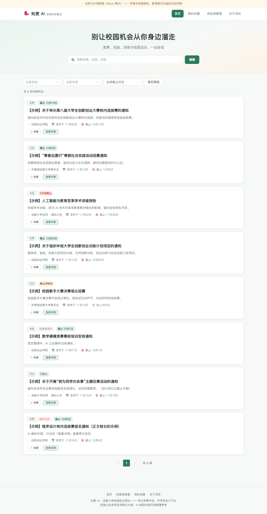
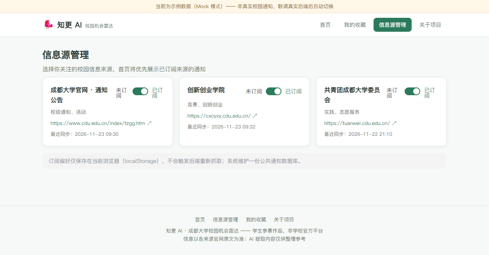
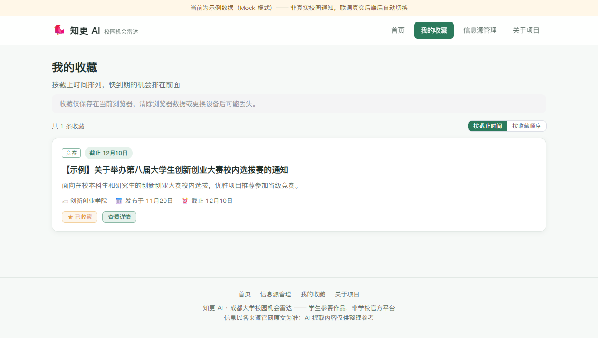
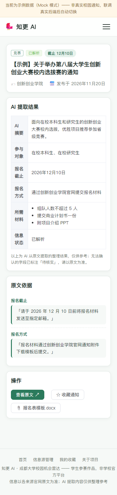
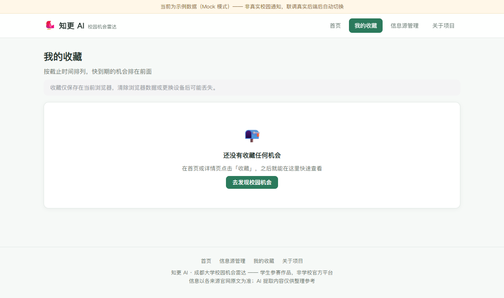

# 知更 AI · 成都大学校园机会雷达

> 自定义信息源聚合器：配置一批来源（公众号、学校官网、通知页），系统定时抓取、解析正文与附件，把各类通知清洗进一张清晰的表格，并按类型、时间、关键词筛选。

成都大学第八届网络创新大赛 · AI 创作挑战赛（进阶组）参赛作品。**本仓库为参赛作品，非学校官方平台。**



## 它解决什么问题

校园通知散落在学校官网、各学院站点、公众号与班级群里：格式不统一、截止日期藏在正文第三段、附件要一个个点开。知更 AI 把这件事收敛成三件事：

| 痛点 | 做法 |
| --- | --- |
| 通知分散、要挨个网站刷 | 自定义信息源，定时抓取，统一入库 |
| 关键信息藏在长文里 | AI 抽取报名截止、参与对象、报名方式、所需材料，并保留原文依据 |
| 不知道该先做哪个 | 按截止时间排序，7 天内截止高亮，支持关键词/类型/来源筛选 |

## 界面预览

| 首页（筛选 + 排序） | 通知详情（AI 字段 + 原文依据 + 正文） |
| --- | --- |
|  |  |

| 信息源管理 | 我的收藏 |
| --- | --- |
|  |  |

移动端：

| 首页 | 详情 | 收藏空态 |
| --- | --- | --- |
|  |  |  |

> 截图对应 v0.2。截图内容为 **Mock 模式的虚构示例数据**，页面顶部有黄色提示条标识。

## 已实现的功能

**检索与筛选**
- 关键词搜索（标题 / 摘要 / 分类），支持空结果引导
- 分类、来源、截止状态（7 天内 / 未截止 / 已截止 / 待核实）三重筛选
- 排序：最近截止优先（默认，已截止沉底、无截止日期最后）、最新发布优先
- 分页；**筛选条件全部写入 URL**，刷新不丢、链接可直接分享、浏览器前进后退可用

**详情展示**
- AI 提取字段：摘要、参与对象、报名截止、报名方式、所需材料
- 原文依据：每条字段对应的原文片段，可一键「在正文中定位」并在正文中高亮
- 原文正文：抓取清洗后的正文（默认折叠长文），原文链接失效时仍可核对
- 附件下载、收藏、查看原文

**其他**
- 信息源订阅（仅展示已订阅来源），本地持久化
- 收藏列表按截止时间排序，已下架通知友好提示
- 全站骨架屏 / 空态 / 错误重试 / 移动端适配

## 技术栈

Vue 3 + Vite + TypeScript + Element Plus + Vue Router + Axios（Sass）· Vitest + @vue/test-utils

## 目录结构

```
.
├── frontend/              # 前端工程（Vue 3 + Vite + TS）
│   ├── src/
│   │   ├── api/           # 接口层：notices / sources / request，含 Mock 实现
│   │   ├── components/    # SearchBar / FilterPanel / NoticeCard / DeadlineBadge / EmptyState
│   │   ├── views/         # 首页 / 详情 / 信息源 / 收藏 / 关于
│   │   ├── utils/         # 日期与截止状态、排序、正文高亮、本地存储
│   │   ├── types/         # 前后端共用的数据类型（唯一事实来源）
│   │   └── styles/        # 设计变量与全局样式
│   └── tests/             # Vitest 单元测试（8 个文件 / 61 个用例）
├── docs/                  # 前端测试与用户反馈记录
└── preview/               # 界面截图
```

## 快速开始

```bash
cd frontend
npm install
npm run dev       # http://localhost:5173
npm run test      # 单元测试（61 个用例）
npm run build     # 类型检查 + 生产构建
```

默认走 **Mock 模式**（`frontend/.env.development` 中 `VITE_USE_MOCK=true`），使用 8 条虚构示例通知，前端可完全独立运行。联调真实后端时改为 `false`，请求经 Vite 代理转发到 `http://localhost:8000`。

接口约定、字段类型与扩展参数见 [`frontend/README.md`](frontend/README.md)。

## 测试

```bash
cd frontend
npm run test
```

覆盖范围：截止状态与日期计算、列表排序、关键词高亮切分、收藏与订阅的本地存储、Mock 检索/筛选/分页行为、`NoticeCard` 组件渲染与事件、以及示例数据自检（保证每条「原文依据」都能在正文中找到）。用例与手工测试记录见 [`docs/前端测试与用户反馈记录.md`](docs/前端测试与用户反馈记录.md)。

## 分工

| 角色 | 负责范围 | 交付物 |
| --- | --- | --- |
| 前端 | 页面设计与开发、信息展示与检索交互、用户体验测试与优化 | 可运行前端页面、检索筛选与详情模块、测试与反馈记录 |
| 后端 | 信息源配置、定时抓取、正文与附件解析、AI 字段抽取、接口服务 | 采集与解析服务、`/api/v1` 接口 |

## 已知边界（诚实声明）

- 收藏与订阅仅保存在当前浏览器，无账户体系，换设备不同步。
- 截止日期只展示原文明确写出的时间，不做「未写则默认 23:59」的推断；无法确认时标注「待核实」。
- AI 提取结果仅供参考，页面保留原文依据与正文供核对。
- 第一版未接入真实抓取链路，仓库内为前端工程 + Mock 数据。

## 版权与声明

参赛作品，非成都大学官方平台；通知内容版权归各来源网站所有，本项目仅做聚合与排版清洗，所有条目均保留原文链接。
